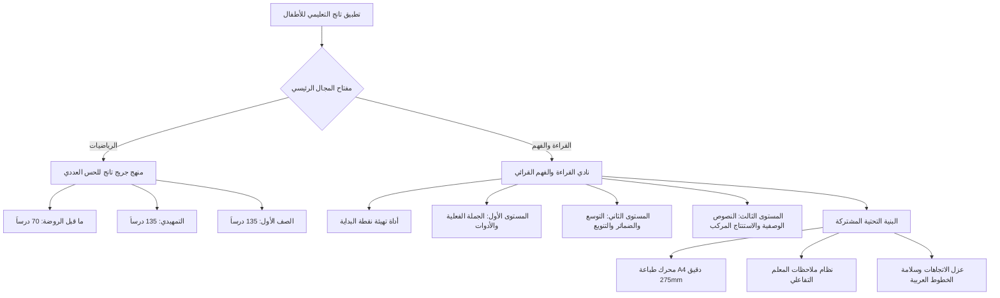

# وثيقة التصميم والمقترح التنفيذي الشامل:

# «نادي القراءة والفهم القرائي — ما بعد مرحلة التأسيس»

### امتداد منهجي لتطبيق رياضيات تانج للأطفال (Tang Math Arabic Platform)

---

## ١. الملخص التنفيذي والرؤية العامة

يهدف هذا المشروع إلى توسيع منصة **«رياضيات تانج للأطفال»** القائمة لتضم مساراً تعليمياً موازياً ومكتملاً لتعليم **القراءة والفهم القرائي لما بعد مرحلة التأسيس**، مستنداً حرفياً وروحياً إلى:

> **«خطة عملية لتعميق القراءة والفهم — ما بعد مرحلة التأسيس»**

لا يتعامل هذا المقترح مع القراءة باعتبارها «بنك أسئلة رقمي» أو مجرد «اختبارات بعدية صامتة»، بل يصوغ التطبيق كـ **بيئة تدريبية تفاعلية وشريك تدريسي (Co-pilot)** يجمع بين:

1. **شاشة تفاعلية للمعلم وولي الأمر** ترشده خطوة بخطوة خلال دورة القصة وتقدم له نصوص النمذجة وإشارات تجنب النقاط العمياء وسجل الرصد.
2. **ورقة عمل مطبوعة A4 عالية الجودة** منسقة بدقة مليمترية (Zero Print Overflow) تجمع بين نص القصة، أسئلة الفهم الثلاثية (QAR)، معمل النحو الاستقرائي، ومساحة التعبير المتدرج.
3. **محرك تدريجي للدعم (Scaffold Engine)** يتيح خفض المساعدة بالتدريج (التلوين، التشكيل، درجة التلميح) وفق **«قاعدة الشرط الواحد»**.

---

## ٢. الفلسفة الموجِّهة وقواعد الامتثال التربوي

يلتزم التصميم بالركائز الخمس الأساسية الواردة في الوثيقة:

```
                  ┌─────────────────────────────────────────┐
                  │          القراءة صناعة معنى              │
                  │   كل نشاط، حتى النحو، خادم للفهم         │
                  └────────────────────┬────────────────────┘
                                       │
         ┌─────────────────────────────┼─────────────────────────────┐
         ▼                             ▼                             ▼
┌──────────────────┐          ┌──────────────────┐          ┌──────────────────┐
│ الاستقراء أولاً  │          │ المساعدة مؤقتة    │          │  المتعة شرط      │
│ القاعدة من النص  │          │ بالتحكم والتصميم │          │ جلسات قراءة حرة  │
│ لا تلقين قبلها   │          │ (قاعدة الشرط 1)  │          │ بلا أدنى أسئلة   │
└──────────────────┘          └──────────────────┘          └──────────────────┘
                                       │
                                       ▼
                  ┌─────────────────────────────────────────┐
                  │          النقل هو المحك الحقيقي          │
                  │  القياس على نصوص جديدة لم يسبق حفظها     │
                  └─────────────────────────────────────────┘
```

### التمييز الصارم بين ما هو مدعوم بأبحاث وما هو تنفيذي تجريبي:

- **عناصر مدعومة بأبحاث موثوقة (NRP & QAR):**
  1. القراءة الجهرية المتكررة الموجَّهة مع التغذية الراجعة الفورية لتعزيز الطلاقة والدقة.
  2. تصنيف الأسئلة وفق علاقة السؤال بمكان الجواب (استراتيجية QAR).
- **عناصر تنفيذية قابلة للتعديل والمواءمة:**
  1. نظام تلوين الكلمات المستهدفة (Sight Words) وخفضه.
  2. إيقاع «دورة القصة» الزمني والجلستي.
  3. بطاقات الإعداد وقوالب سجل المتابعة.

---

## ٣. التكامل المعماري مع بنية التطبيق القائمة

يحافظ التطبيق على استقرار نظام الرياضيات الحالي (Pre-K, K, G1) مع إعادة استخدام البنية التحتية الممتازة عبر محول مجالات رئيسي:



### عناوين التوجيه (Hash Routing):

- `#/reading` — الصفحة الرئيسية لمسار القراءة والمستويات.
- `#/reading/diagnostic` — أداة تهيئة نقطة البداية (اختبار القراءة مقابل الاستماع).
- `#/reading/level/:levelId` — شبكة قصص المستوى.
- `#/reading/level/:levelId/story/:storyId` — عرض قصة تفاعلية وطباعية متكاملة.

---

## ٤. وحدة التنفيذ التشغيلية: «دورة قصة» (The Story Cycle)

الوحدة التعليمية ليست الجلسة الواحدة ولا الأسبوع، بل **دورة قصة** تتوزع تشغيلياً على جلستين إلى ثلاث جلسات (٢٠–٢٥ دقيقة للجلسة)، وتنتهي دوماً قبل ملل الطفل:

| المحطة                                | الهدف المنهجي                                                                 | ما يوفره التطبيق على الشاشة                                                                | ما تتضمنه ورقة الطالب A4                                        |
| ------------------------------------- | ----------------------------------------------------------------------------- | ------------------------------------------------------------------------------------------ | --------------------------------------------------------------- |
| **١. القراءة الأولى (اكتشاف المعنى)** | الاستماع لنموذج المعلم ثم قراءة الطفل لاكتشاف المعنى العام بلا مقاطعات نحوية. | زر استماع لنموذج صوتي مقترح أو قراءة المعلم، مع زر إخفاء/إظهار الأسئلة لحماية تركيز الطفل. | نص القصة في موضع الصدارة بخط نسخي مريح ومشكول جزئياً.           |
| **٢. القراءة الموجّهة (الطلاقة)**     | إعادة القراءة الجهرية المتكررة لضبط السلاسة والتعبير الصوتي والتصحيح اللطيف.  | عداد سرعة هادئ (اختياري) مع تعليمات وتنبيه: «الوقف الصحيح ليس خطأً».                       | نص القصة المطبوع مع إبراز الكلمات المستهدفة.                    |
| **٣. الأسئلة والتحليل (QAR)**         | استنتاج الدليل وتدريب الذهن على السؤال: «أين تعيش هذه الإجابة؟»               | زر تفاعلي «أين يعيش الجواب؟» يبرز موضع الدليل في النص للنمذجة أمام الطفل.                  | ٣ مستويات أسئلة: (مباشر، استنتاجي، إبداعي) مع أسطر كتابة مريحة. |
| **٤. النحو الاستقرائي**               | استخلاص القاعدة من النص: مثال ← ملاحظة ← تسمية ← إنتاج.                       | بطاقة استقراء تفاعلية تسلط الضوء على التركيب في القصة وتطلب صياغة مماثلة.                  | صندوق «معمل اللغة»: مثال محلول وسؤال إنتاج جملة مماثلة.         |
| **٥. التعبير والإنتاج**               | التعبير الشفهي أولاً، ثم التدرج نحو جملة مكتوبة.                              | اقتراح لنشاط التعبير الشفهي مع نصائح المعلم لقبول المعنى ولو صيغ بالعامية.                 | سطر مسطر بجودة عالية مخصص لكتابة الجملة المنتجة.                |
| **٦. المراجعة اللاحقة والنقل**        | التحقق من رسوخ المفهوم في قصة لاحقة مستقلة.                                   | ربط تلقائي بدرس المراجعة التالي وإشعار للمعلم بدرجة النقل.                                 | إدراج الهدف القديم ضمن سياق القصة الجديدة بشكل طبيعي.           |

---

## ٥. هندسة التدرج متعدد الأبعاد وقاعدة الشرط الواحد

التدرج لا يعتمد على إطالة النص فحسب، بل يضبط **٦ أبعاد متوازية**، مع الالتزام الصارم بـ:

> **قاعدة الشرط الواحد:** نغيّر شرطاً واحداً فقط في المرة الواحدة عبر القصص المتتابعة، ونبقي الشروط الأخرى متقاربة.

```
       [1. طول النص: من 50 إلى 80 ثم 120 كلمة]
       [2. مألوفية المفردات: كلمات شائعة ← كلمات معجمية جديدة سياقياً]
       [3. تعقيد الجمل: جمل بسيطة ← جمل ممتدة بروابط وعطف]
       [4. مرجع الضمائر: ضمائر ظاهرة قريبة ← ضمائر غائبة مستترة أو بعيدة]
       [5. نوع السؤال: غلبة المباشر ← غلبة الاستنتاجي التكاملي]
       [6. حجم المساعدة: نمذجة كاملة ← تلميح عام ← استقلال كامل]
```

### قواعد اتخاذ القرار التشغيلية المدمجة في النظام:

1. **التحسن على النص المتدرب فقط:** يوجه التطبيق المعلم إلى «اختبار نص جديد مماثل» قبل رفع الصعوبة لضمان عدم الحفظ.
2. **قراءة دقيقة مع فهم ضعيف:** يطلق النظام إشعاراً: «راجع المفردات والمعنى شفهياً؛ لا تطلب مزيداً من السرعة».
3. **فهم شفهي ممتاز مع تعثر في الكتابة:** يوجه النظام المعلم: «خفف عبء الكتابة إلى شفهي أو كلمة واحدة؛ لا تحسبه ضعف فهم».
4. **تزايد التعثر أو ضيق الطفل:** يقترح النظام فوراً: «انزل بُعداً واحداً من الصعوبة وعُد إلى منطقة الأمان والمتعة».
5. **قاعدة التقدم الإيجابية:** عند تحقيق قراءة مستقلة لنص جديد مع إجابة دقيقة في فرصتين متتاليتين ← ترقية بُعد واحد.

---

## ٦. محتوى المستويات القرائية (Level-wise Curriculum Plan)

### المستوى الأول: الانطلاق وبناء المعنى (١٢ دورة قصة)

- **طول النصوص:** ٥٠ إلى ٧٥ كلمة.
- **الكلمات المستهدفة:** ٥ كلمات شائعة لكل قصة تلون في نسخة التدريب.
- **التشكيل:** تشكيل بنية الكلمات وتنوين الأواخر وأوائل الأفعال.

| رقم الدورة | عنوان القصة                  | الهدف النحوي الرئيس (استقرائي)        | الكلمات المستهدفة                 | طبيعة القصة والحدث                      |
| :--------: | ---------------------------- | ------------------------------------- | --------------------------------- | --------------------------------------- |
|   **١**    | لولو في الحديقة              | الجملة الفعلية: الفاعل الصريح         | في، من، إلى، قال، نام             | حدث بسيط: هروب قط واكتشاف حديقة المنزل. |
|   **٢**    | عصير الفواكه                 | المفعول به المباشر (مع مراجعة الفاعل) | هذا، مع، ماذا، شرب، كان           | تعاون طفلين لصنع عصير وسكب الكوب.       |
|   **٣**    | العصفور الصغير               | حروف العطف: (الواو، الفاء)            | رأى، فوق، على، طار، حتى           | إنقاذ فرخ صغير سقط من العش.             |
|   **٤**    | 🌟 **قراءة حرة للمتعة**      | قراءة ممتعة مطلقة (بلا أدنى أسئلة)    | حرية اختيار للنص                  | قصة شائقة خيالية بلا تكليف أو تمرين.    |
|   **٥**    | سباق السلاحف                 | حرف العطف: (ثم) ودلالة التراخي        | مشى، بعد، وصل، فاز، بطيء          | مغامرة سباق مضحكة تثبت الصبر.           |
|   **٦**    | 🎯 **اختبار النقل ١**        | قياس استقلال: الفاعل والمفعول         | نص جديد بلا تلوين وبلا إرشاد مسبق | زيارة إلى مزرعة الجد.                   |
|   **٧**    | اللعبة المفقودة              | الضمائر المتصلة البسيطة (ـه، ـها)     | أين، تحت، وجد، بحث، كان           | البحث عن دمية ضائعة واكتشاف مكانها.     |
|   **٨**    | يوم ماطر                     | جملة النفي البسيطة (لا / ما)          | ماء، سماء، مطر، نزل، رجع          | محاولة الخروج تحت المطر وارتداء المظلة. |
|   **٩**    | في متجر الألعاب              | ظرفا المكان (أمام / خلف)              | كبير، صغير، نظر، أراد، هناك       | اختيار هدية بسيطة لصديق.                |
|   **١٠**   | 🌟 **قراءة حرة للمتعة**      | قراءة لاختيار الطفل بلا أي أسئلة      | نصوص شائقة مفتوحة                 | حكاية عن قطار الحيوانات.                |
|   **١١**   | شجرة التوت                   | الجملة الاسمية البسيطة للمطالعة       | شجرة، حلو، أكل، جاء، جلس          | نمو حبات التوت واقتسام الثمار.          |
|   **١٢**   | 🎯 **اختبار النقل التراكمي** | قياس النقل الشامل للمستوى الأول       | نص غير مسبوق بمساعدة صفرية        | مغامرة قارب الورق في الجدول.            |

---

## ٧. سُلّم التعبير والإنتاج الكتابي (The Production Ladder)

يتدرج التطبيق في طلب المخرجات من الطفل وفق الدرجات الخمس المقررة:

```
[الدرجة 5] سيناريو بديل مكتوب (تغيير نهاية القصة أو اختراع مشهد جديد)
      ▲
[الدرجة 4] ثلاث جمل متصلة ومترابطة (بداية / حدث / نهاية)
      ▲
[الدرجة 3] جملة واحدة مكتوبة بخط يد الطفل
      ▲
[الدرجة 2] جملة واحدة شفهية على النمط المستهدف
      ▲
[الدرجة 1] جواب شفهي لسؤال مفتوح (مثال: «لو كنت مكان سعيد، ماذا تفعل؟»)
```

> **توجيه إلزامي للمعلم داخل التطبيق:**  
> «الأسئلة الإبداعية تقبل بدائل متعددة، ولا توجد إجابة نموذجية واحدة. التقييم مبني على وضوح المعنى والاتساق مع سياق القصة لا على المطابقة الحرفية».

---

## ٨. أدوات المعلم والتحصين ضد النقاط العمياء التسع

يوفر التطبيق للمربي والمعلم لوحة منسدلة ذكية (`TeacherPanel`) تحميه من الوقوع في الأخطاء الشائعة:

```
┌────────────────────────────────────────────────────────────────────────┐
│ 👩‍🏫 درع المعلم التعليمي — حماية ضد النقاط العمياء                        │
├────────────────────────────────────────────────────────────────────────┤
│ 1. الفصحى والعامية: اقبل إجابة الطفل بالعامية لتثبيت الفهم، ثم نمذجها:  │
│    «أحسنت! معناها كذا، وبالفصحى نصوغها هكذا...»                      │
│ 2. الوقف ليس خطأ: لا تحسب توقف الطفل عند نهاية الجملة عثرة قرائية.    │
│ 3. الحفظ ليس إتقاناً: لا تعتمد قراءة الطفل للنص نفسه دليلاً على التعلم. │
│ 4. تجنب التصحيح المفرط: ركّز على خطأ واحد محدد في الجلسة وشجع ما أتقن. │
│ 5. روتين ثابت: ترتيب خطوات الجلسة ثابت دائماً لخفض التوتر والقلق.      │
│ 6. ليست كل جلسة امتحاناً: استمتع بالقصة ولا تجعل اليوم كله أسئلة.      │
└────────────────────────────────────────────────────────────────────────┘
```

### سجل المتابعة التفاعلي (Interactive Tracking Matrix)

لكل قصة، يُتاح للمعلم تدوين رصد سريع بنقرة واحدة يُحفظ محلياً أو يُطبع:

| البند                   | خيارات الرصد التفاعلية                                                                               |
| ----------------------- | ---------------------------------------------------------------------------------------------------- |
| **درجة المساعدة**       | `[ ] مستقل تماماً` • `[ ] تلميح عام ("أين تنظر؟")` • `[ ] توجيه للجملة` • `[ ] نمذجة المعلم الكاملة` |
| **مستوى الفهم القرائي** | `[ ] فهم عميق ومباشر` • `[ ] فهم جزئي بمساعدة` • `[ ] ضعف في الفهم (يحتاج مراجعة مفردات)`            |
| **قرار الخطوة التالية** | `[ ] تثبيت بنص مماثل` • `[ ] ترقية بُعد واحد` • `[ ] تخفيف الكتابة` • `[ ] العودة للأمان`            |

---

## ٩. تصميم ورقة العمل المطبوعة A4 (Printable Sheet Layout)

تلتزم الورقة بمعايير الطباعة الصارمة المطبقة في مرحلة التمهيدي:

- القياس: **A4 نظامي (210mm × 297mm)**.
- الميزانية الرأسية: **أقل من 275mm** لضمان عدم حدوث أي صفحة زائدة (`Zero Overflow`).
- خلو كامل من الإعلانات والأزرار (`no-print` classes).
- أسطر كتابة بارتفاع مناسب للخط العربي للأطفال (10mm بين السطور مع خط أساس منقط).

```
+--------------------------------------------------------------------------+
|  [شعار المسار]        نادي القراءة والفهم القرائي — المستوى الأول           [الصفحة ١/١]  |
|  الاسم: ......................  التاريخ: ... / ... / ١٤٤...  القصة: لولو في الحديقة |
+--------------------------------------------------------------------------+
|                                                                          |
|  [📖 نص القصة المشكول - خط عربي واضح وكبير 18pt]                         |
|  في بيتِ سعيدٍ قِطٌّ صغيرٌ اسمُهُ لولو.                                    |
|  نامَ لولو تحتَ الطاولةِ، فرآهُ سعيدٌ نائمًا فضحكَ.                        |
|  قالَ سعيدٌ: هيا يا لولو، اللعبُ في الحديقةِ أفضلُ من النومِ!               |
|  خرجَ سعيدٌ إلى الحديقةِ، ثم تبِعَهُ لولو فرِحًا.                          |
|  لعبَ لولو بالكرةِ، وأخذَ سعيدٌ عصًا صغيرةً، ثم رسمَ بها بيتًا في الرملِ.    |
|  وعندَ الغروبِ عادَ الصديقانِ إلى البيتِ، فنامَ لولو في سلّتِهِ.             |
|                                                                          |
+--------------------------------------------------------------------------+
|  🔍 أسئلة الفهم (أين تعيش الإجابة؟):                                     |
|  ١. [مباشر] أين نام لولو أولاً؟                                          |
|     ...................................................................  |
|  ٢. [استنتاجي] هل كان لولو سعيداً بالخروج؟ وما الكلمة التي دلت على ذلك؟     |
|     ...................................................................  |
|  ٣. [إبداعي] لو كنتَ معهما في الحديقة، ماذا كنتَ سترسم في الرمل؟            |
|     ...................................................................  |
+--------------------------------------------------------------------------+
|  🧩 معمل اللغة (اكتشف القاعدة):                                          |
|  «نامَ لولو» — مَن الذي نام؟ (لولو) • «رسمَ سعيدٌ» — مَن الذي رسم؟ (سعيد)    |
|  * الاسم الذي يدل على مَن فعل الفعل نسميه: (الفاعل).                     |
|  * اكتب أنت جملة فعلية تبدأ بفعل، وضع خطاً تحت الفاعل:                   |
|     ...................................................................  |
+--------------------------------------------------------------------------+
```

---

## ١٠. البنية البرمجية ونموذج البيانات (`readingCurriculum.js`)

يتم إيداع بيانات المنهج في ملف مهيكل ونظيف:

```javascript
export const READING_STAGES = [
  {
    id: "read_l1",
    levelNumber: 1,
    title: "المستوى الأول: الانطلاق وبناء المعنى",
    shortLabel: "المستوى الأول",
    mascot: "📖",
    color: "#059669",
    bgColor: "#d1fae5",
    wordsRange: "٥٠–٧٥ كلمة",
    desc: "بناء الجملة الفعلية، الفاعل والمفعول، حروف العطف الأساسية، وإتقان أسئلة الفهم الثلاثية.",
    stories: [
      {
        id: 1,
        title: "لولو في الحديقة",
        type: "standard_story",
        wordCount: 52,
        targetWords: ["في", "من", "إلى", "قال", "نام"],
        coreGoal: "الجملة الفعلية: استنتاج الفاعل الصريح",
        reviewedGoal: "استكشاف الأفعال الماضية البسيطة",
        tashkeelDefault: "partial",
        text: `في بيتِ سعيدٍ قِطٌّ صغيرٌ اسمُهُ لولو.
نامَ لولو تحتَ الطاولةِ، فرآهُ سعيدٌ نائمًا فضحكَ.
قالَ سعيدٌ: هيا يا لولو، اللعبُ في الحديقةِ أفضلُ من النومِ!
خرجَ سعيدٌ إلى الحديقةِ، ثم تبِعَهُ لولو فرِحًا.
لعبَ لولو بالكرةِ، وأخذَ سعيدٌ عصًا صغيرةً، ثم رسمَ بها بيتًا في الرملِ.
وعندَ الغروبِ عادَ الصديقانِ إلى البيتِ، فنامَ لولو في سلّتِهِ.`,
        questions: [
          {
            type: "direct",
            categoryLabel: "مباشر — ضع إصبعك عليه",
            prompt: "أين نام لولو أولاً؟",
            answer: "تحت الطاولة",
            textEvidenceSnippet: "نامَ لولو تحتَ الطاولةِ",
          },
          {
            type: "inferential",
            categoryLabel: "استنتاجي — الجواب في القرائن",
            prompt: "هل بدا لولو راغباً في الخروج مع سعيد؟ ما دليلك من القصة؟",
            answer: "نعم، الدليل قوله: «تبعه فرحاً»",
            textEvidenceSnippet: "ثم تبِعَهُ لولو فرِحًا",
          },
          {
            type: "creative",
            categoryLabel: "إبداعي — أنت والقصة معاً",
            prompt:
              "لو خرجتَ معهما إلى الحديقة، ماذا كنتَ ستلعب؟ قلها ثم اكتب جملة.",
            answer: "إجابة حرة مقبولة متسقة مع السياق.",
          },
        ],
        inductiveGrammar: {
          conceptName: "الفاعل",
          step1Examples: [
            { phrase: "نامَ لولو", question: "مَن الذي نام؟", answer: "لولو" },
            { phrase: "رسمَ سعيدٌ", question: "مَن الذي رسم؟", answer: "سعيد" },
          ],
          step2Observation: "الاسم الذي يدل على مَن قام بالفعل يسمى: الفاعل.",
          step3ProductionPrompt:
            "أكمل الجملة واذكر الفاعل: «أكلَ ...... التفاحةَ»",
        },
        teacherGuide: {
          modelingScript:
            'سؤال "أين نام لولو" يبحث عن مكان. أبحث في النص بعيني عن كلمة "نام"... وجدتها في السطر الثاني: "نام لولو تحت الطاولة". أضع إصبعي عليها وأصوغ الجواب بوضوح.',
          sessionTips: [
            "لا تقاطع قراءة الطفل الأولى لتصحيح النحو.",
            'إذا أجاب بالعامية: "تحت الترابيزة"، قل له: رائع! وبالفصحى نقول: تحت الطاولة.',
            "تأكد من إنهاء الجلسة قبل أن يشعر الطفل بالإرهاق.",
          ],
        },
      },
      // تتابع بقية القصص الـ 12...
    ],
  },
];
```

---

## ١١. خارطة الطريق للتنفيذ (Implementation Roadmap)

|    المرحلة    | الأهداف والمخرجات                                                                                                                                                                                                       | المدة التقديرية |
| :-----------: | ----------------------------------------------------------------------------------------------------------------------------------------------------------------------------------------------------------------------- | :-------------: |
| **المرحلة ١** | • صياغة ملف البيانات المنهجية الكامل للمستوى الأول [`src/data/readingCurriculum.js`](file:///d:/Ahmed/Tang/src/data/readingCurriculum.js).<br>• توفير قصص الدورة الأولى (سعيد ولولو، عصير الفواكه، العصفور، قراءة حرة). |     يوم عمل     |
| **المرحلة ٢** | • بناء مكوّن عرض القصة والأسئلة `StoryRenderer.js`.<br>• تطوير أدوات التحكم التفاعلية: إظهار/إخفاء تلوين الكلمات المستهدفة، التبديل بين درجات التشكيل، وإبراز مواضع الأدلة.                                             |     يوم عمل     |
| **المرحلة ٣** | • تطوير لوحة المعلم الذكية وسجل المتابعة الميداني `ReadingTeacherPanel.js`.<br>• برمجة أداة قياس نقطة البداية (اختبار الاستماع مقابل القراءة).                                                                          |     يوم عمل     |
| **المرحلة ٤** | • هندسة أنماط الطباعة A4 المتقنة في `print.css` مع ضمان Zero Overflow التام.<br>• ربط المسار بنافذة التبديل المركزية في `Navbar.js` و`main.js`.                                                                         |     يوم عمل     |
| **المرحلة ٥** | • التدقيق النهائي الشامل (Smoke tests & Consistency check).<br>• مراجعة ملاءمة الخطوط والهوامش وسلاسة التنقل.                                                                                                           |     يوم عمل     |

---

## ١٢. خاتمة القرار

هذا المقترح يمثل وثيقة هندسية وتربوية متكاملة تضمن نقل وثيقة:
**«خطة عملية لتعميق القراءة والفهم — ما بعد مرحلة التأسيس»**
من مجرد إرشادات نظرية إلى **أداة حية، سهلة الاستخدام، مبهرة بصرياً، ودقيقة تربوياً** تعين المربي والطفل خطوة بخطوة نحو التمكن القرائي الأصيل.
